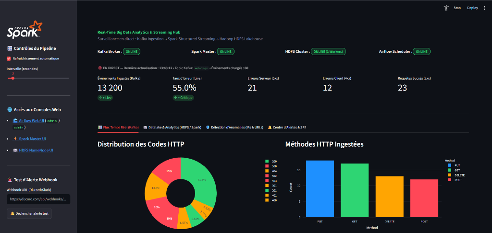
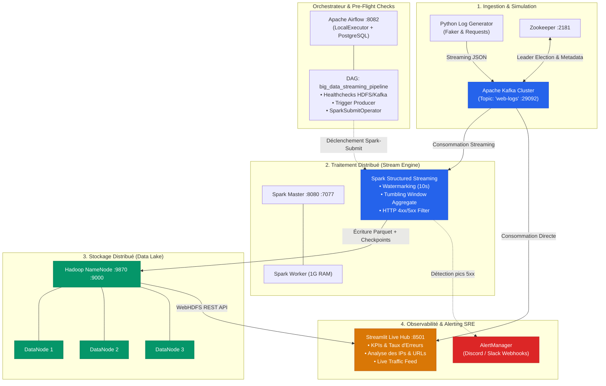

# ⚡ Real-Time Big Data Streaming & Observability Lakehouse

[](https://www.python.org/)
[](https://kafka.apache.org/)
[](https://spark.apache.org/)
[](https://airflow.apache.org/)
[](https://hadoop.apache.org/)
[](https://streamlit.io/)
[](https://www.docker.com/)
[](#-tests--qualit%C3%A9-de-donn%C3%A9es)

> **Pipeline industriel de traitement de flux d'événements à grande échelle (Big Data Streaming)** intégrant ingestion temps réel, calcul distribué à basse latence, stockage résilient en Data Lakehouse, orchestration automatisée et monitoring avec observabilité SRE.

<p align="center">
  
</p>

---

## 🏛️ Architecture du Pipeline



---

## 🚀 Fonctionnalités Clés & Choix d'Architecture

- **Ingestion Haute Vélocité :** Production de logs HTTP réalistes en continu vers un broker **Apache Kafka** partitionné avec double listener (`PLAINTEXT://kafka:9092` pour le réseau inter-conteneurs et `localhost:29092` pour l'hôte).
- **Calcul Distribué Basse Latence :** Traitement continu via **Apache Spark Structured Streaming (PySpark)** :
  - **Watermarking temporel (10s)** pour absorber la désynchronisation des événements sans accumulation d'état infini en mémoire.
  - **Fenêtrage glissant (Tumbling Window)** calculant les métriques d'erreur HTTP (`4xx` et `5xx`) par tranches de 10 secondes.
- **Stockage Datalake Distribué (HDFS Multi-Nœuds) :** 
  - 1 **NameNode** et **3 DataNodes** physiques virtualisés.
  - Sauvegarde en format colonnaire compressé **Parquet** (`/output/web-errors`) optimisant les coûts d'I/O et de requêtage analytique.
  - Gestion des reprises sur panne via HDFS Checkpointing (`/checkpoints/web-errors`).
- **Orchestration & Résilience (Airflow) :** 
  - DAG complet avec vérifications préalables de connectivité (`check_hdfs_is_up`, `check_kafka_is_up`).
  - Utilisation de `SparkSubmitOperator` pour soumettre les workloads de streaming au cluster Spark de façon idempotente.
- **Observabilité & Alerting SRE en Temps Réel :**
  - **Dashboard Streamlit Interactif (Port 8501)** : Cartographie des anomalies, surveillance des composants, latence et volume d'ingestion.
  - **AlertManager modulaire** : Envoi instantané d'alertes enrichies vers **Discord / Slack** avec filtrage anti-tempête (rate-limiting).
- **CI/CD & Tests Automatisés :** Validation unitaire via **Pytest** et pipeline GitHub Actions intégré.

---

## 🛠️ Stack Technologique & Matrice des Ports

| Composant | Technologie | Version | Rôle & Utilité | Port / Accès |
| :--- | :--- | :--- | :--- | :--- |
| **Message Broker** | Apache Kafka | `7.4.0` | Buffer d'ingestion distribué | `localhost:29092` |
| **Coordination** | Apache ZooKeeper | `7.4.0` | Gestion de cluster Kafka | `localhost:2181` |
| **Stream Processing** | Apache Spark | `3.3.0` | Calcul analytique en streaming | `localhost:8080` *(Web UI)* |
| **Data Lake** | Hadoop HDFS | `3.2.1` | Stockage colonnaire Parquet (3 Datanodes) | `localhost:9870` *(Web UI)* |
| **Orchestrateur** | Apache Airflow | `2.7.3` | Planification et surveillance des jobs | `localhost:8082` *(Web UI)* |
| **Metadata DB** | PostgreSQL | `13-alpine` | Métadonnées de l'orchestrateur | `localhost:5432` |
| **Visualisation** | Streamlit + Plotly | `1.40+` | Hub d'observabilité en direct | `localhost:8501` *(Dashboard)* |
| **Notifications** | Webhooks REST | - | Alerting incident SRE (Discord/Slack) | Sortant HTTPS |

---

## ⚡ Guide de Démarrage Rapide

### 1. Prérequis
- Docker Desktop installé et démarré (avec au minimum 4 Go de RAM alloués).
- Python 3.10+ avec `pip`.

### 2. Cloner et démarrer l'infrastructure
```bash
# Cloner le dépôt
git clone https://github.com/votre-compte/big-data-pipeline.git
cd big-data-pipeline

# Démarrer tous les conteneurs (Kafka, Zookeeper, Hadoop, Spark, Airflow)
docker compose up -d
```

### 3. Installer les dépendances Python locales
```bash
pip install -r requirements.txt
```

### 4. Lancer le Dashboard d'Observabilité
```bash
streamlit run dashboard.py
```
👉 Accédez au tableau de bord sur **[http://localhost:8501](http://localhost:8501)**.

### 5. Lancer l'ingestion & le pipeline
Dans un autre terminal :
```bash
# Lancer la génération de requêtes en continu vers Kafka
python log_generator.py
```

Puis déclenchez le DAG complet sur **[http://localhost:8082](http://localhost:8082)** (*User: `admin` / Password: `admin`*) ou directement en ligne de commande :
```bash
docker exec airflow-webserver airflow dags trigger big_data_streaming_pipeline
```

---

## 🔍 Validation et Requêtage des Données HDFS

Pour explorer les résultats agrégés par Spark dans HDFS :

```bash
# 1. Lister les fichiers Parquet dans le Datalake
docker exec namenode hdfs dfs -ls /output/web-errors

# 2. Exécuter le script de lecture Spark
docker exec spark-master /spark/bin/spark-submit /read_results.py
```

Exemple de résultat obtenu :
```text
--- STRUCTURE DES DONNÉES ---
root
 |-- window: struct (start: timestamp, end: timestamp)
 |-- status: integer
 |-- count: long

--- RÉSULTATS DE L'AGRÉGATION (FENÊTRES DE 10 SECONDES) ---
+------------------------------------------+------+-----+
|window                                    |status|count|
+------------------------------------------+------+-----+
|{2026-10-11 12:45:20, 2026-10-11 12:45:30}|404   |3    |
|{2026-10-11 12:45:20, 2026-10-11 12:45:30}|500   |2    |
|{2026-10-11 12:45:30, 2026-10-11 12:45:40}|502   |1    |
+------------------------------------------+------+-----+
```

---

## 🧪 Tests & Qualité de Données

Ce projet intègre une suite de tests unitaires garantissant la fiabilité des structures de données, la syntaxe des DAGs et le système d'alerte :

```bash
pytest tests/ -v
```

```text
tests/test_pipeline.py::test_generate_log_structure PASSED               [ 20%]
tests/test_pipeline.py::test_generate_log_valid_types_and_values PASSED  [ 40%]
tests/test_pipeline.py::test_alert_manager_local_logging PASSED          [ 60%]
tests/test_pipeline.py::test_alert_manager_rate_limiting PASSED          [ 80%]
tests/test_pipeline.py::test_airflow_dag_syntax PASSED                   [100%]
============================== 5 passed in 1.08s ==============================
```

---

## 📂 Structure du Répertoire

```text
.
├── .github/
│   └── workflows/
│       └── ci.yml               # Pipeline d'intégration continue GitHub Actions
├── dags/
│   ├── pipeline_dag.py          # DAG Airflow orchestrant tout le pipeline
│   ├── log_generator.py         # Producteur de messages Kafka pour Airflow
│   └── spark_streaming.py       # Script Spark Structured Streaming
├── tests/
│   └── test_pipeline.py         # Suite de tests unitaires Pytest
├── alert_system.py              # Module d'alerting SRE (Discord / Slack)
├── dashboard.py                 # Dashboard interactif Streamlit & Plotly
├── docker-compose.yml           # Déploiement multi-conteneurs de l'infrastructure
├── Dockerfile.airflow           # Image Airflow personnalisée avec OpenJDK 11
├── hadoop.env                   # Configuration d'environnement HDFS
├── log_generator.py             # Producteur de logs local
├── read_results.py              # Script Spark de lecture et audit des Parquet HDFS
├── spark_streaming.py           # Script Spark Streaming racine
├── requirements.txt             # Dépendances Python
└── README.md                    # Documentation officielle du projet
```

---

## 👨‍💻 Auteur & Contact

Projet conçu et réalisé par **Reda** dans le cadre de projets d'ingénierie Big Data.  
N'hésitez pas à me contacter sur **[LinkedIn](https://linkedin.com/)** pour échanger autour des architectures de données temps réel !
